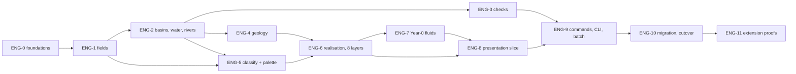

# Endrath world-generation and simulation engine — the build plan

**Status:** proposal for Owner/PM approval, 2026-10-11. Nothing in `game/` changes with this document. It opens no lane and mints no WG id; where a stage needs a WBS leaf, the PM mints it (ids below are plan ids, `ENG-n`).
**Companion:** `ENDRATH_ENGINE_CONTRACTS.md` (data layouts, units, extension rules). The plan says *what, in what order and why*; the contracts say *exactly what the bytes are*.
**Inputs read:** `AGENTS.md`, `docs/STATUS.md`, `docs/OWNER_DECISIONS.md` (DEC-011/012/013/017/019/020/021/024/028/030/038/040/049/065/067/070/073/083/092/095/101), `docs/worldgen/DEUS_WORLDGEN_WBS.md` (WG.00.15–.47, WG.62–68), `docs/adr/ADR-003`, `docs/systems/DEUS_{World,WorldGen,Levels,ZRange,Fluid,WaterAuthority,WaterDynamics,Matter,Depth,Tiles,SimTick}.md`, the plugins and `game/js/sim/**` modules they describe, the DF reference set `docs/worldgen/df_reference/` (techniques T1–T18), and the retrospectives under `tasks/RETROSPECTIVE/`.

---

## Executive summary (one page)

**End state.** A New Game produces a deterministic, globe-topology world in three steps that a developer can run headless or in RPG Maker MZ: (1) a **coarse world** of 96×96 cells (8×8 tiles each, over the 3×3 grid of 256×256-tile maps) holding integer fields for elevation (feet), moisture, temperature proxy, drainage, volcanism and wildness, plus abstract records for basins, rivers (with per-cell crossing points), regions, sites, features and mass reservoirs; (2) **finite water** placed by filling closed basins from the bottom up out of a fixed centipound budget, so the sea level is whatever height is left when the budget is spent, and rivers are the circulation on top of that; (3) **lazy local realisation** of each `(area, z)` into whole-block cells across **eight 10-foot layers**, with a per-tile height 0..9 for presentation and stepping, caves and veins from seeded geology stacks, and Year-0 fluid state posted to the existing conserved fluid kernels. Biome, vegetation and surface material are **never stored**: they are pure functions of the fields and the depth band, and the renderer resolves them to the six Owner-named palette parents (Olive, Ochre, Crimson, Ash, Navy, Icy) with slow, colour-mixing transitions and eight darker shade steps when looking down.

**Locked constants.** 8 layers × 10 ft; surface depth 1 ft; `DEPTH_MAX` 10; overflow divisor 31,200 cp per depth unit; lava stays in centipounds; 5-ft tiles at 48 px; 3×3 areas of 256×256 tiles, data-driven; torus wrap on both axes, no edge masks; palette locked to the U6–U8-derived set, hexes named by the Owner. The engine z-range for new worlds is `-3..+4` (layer 1 = z −3 … layer 8 = z +4); legacy saves keep theirs.

**Extension philosophy.** Fields first, derived values second; records, not geometry, for everything abstract; every stage behind a named contract with explicit read/write rights; every random choice from a named stream passed as an argument; every check and threshold in data. A later biome, effect, area type, weather or history system reads the contracts and adds its own records and streams; it never edits the generator core. The layer count is a constant read everywhere and hard-coded nowhere, so a later Owner decision to raise it is a data change plus art, not a rewrite — but this plan builds and tests at exactly 8.

**Shape of the work.** Twelve stages (ENG-0 … ENG-11), each with entry and exit criteria and the exact modules and plugins it adds or touches. Pure JavaScript lives in `game/js/sim/endrath/` and runs in node, in Web Workers and in the game; four small MZ plugins bind it (`DEUS_Coarse`, `DEUS_Realize`, `DEUS_WaterInit`, `DEUS_Palette`), one optional presentation plugin follows, and three existing plugins change in bounded ways (`DEUS_WorldGen` becomes a facade over the coarse world, `DEUS_Levels` gains generator 7 and the 8-layer range, `DEUS_Fluid`/`open.js` take the depth-unit rule). Two stub plugins are retired from the load list under Owner control. The first playable, inspectable slice (ENG-8) shows a generated area with its eight layers, derived biome colours, finite water and at least one closed basin, under the existing flat 1:1 depth renderer.

---

## 1. Where the engine stands (findings that shape the plan)

What exists and is reused:

| Capability | Where | Reuse |
|---|---|---|
| World of 256×256 areas, map ids per `(area, z)`, in-memory `$dataMap` builds, units in a registry, wrap when `AreasX/Y > 1` (`isLoopHorizontal`), generator registration with `order` and `levels` | `DEUS_World.js`, `docs/systems/DEUS_World.md` | Kept as the world host; the new generator registers through `registerGenerator` |
| Configurable Z range as one setting (`UF.World.Z_RANGES`, `DEUS_Z_RANGE` override), sparse 32×32 chunk baselines (UNIFORM/MIXED), sparse change records, per-area checksums, lazy `(area, z)` generation with lazy-vs-eager tests | `DEUS_Levels.js`, `DEUS_ZRange.md`, WG.00.17/43/46 | Kept as the cell store; a new generator version writes into it; the range for new worlds becomes 8 layers |
| Flat 1:1 depth compositing through open cells, stencil-masked, no filters (DEC-011) | `DEUS_Depth.js` | Kept as the first vertical-slice renderer; gains the palette shade step |
| Runtime-generated A2 ground sheet and Bayer shade tiles | `DEUS_Tiles.js` | Kept; its colour source becomes the palette registry |
| Conserved 0..7 water/lava kernel with dirty queues, 3D flow, displacement accounting; headless centipound open-fluid store that already flows across wrapped seams; aquifers; rain/evaporation return cycle; mass ledger; shared tick clock | `DEUS_Fluid.js`, `sim/hydrology/*`, `sim/hydro/*`, `sim/ledger.js`, `sim/host/tick.js` | Kept as the authority; the generator only places Year-0 state through them |
| Web Worker pool with a SharedArrayBuffer strip protocol, node worker threads for tests, `--enable-features=SharedArrayBuffer` already in `package.json` | `sim/worldgen/worker.js`, `DEUS_World.js` chunk fields | Kept; realisation jobs ride the same pool |
| Macro A* river planner with bed carving and wrap, micro midpoint-displaced courses hashed from absolute coordinates; Minecraft-style jittered climate sampling and IDW top-2 biome blend | `sim/worldgen/DEUS_Hydrology.js`, `DEUS_Biomes.js` | Reused inside the hydrology and classification stages |
| 3D-simplex void manifold for caves, chunk gate predicate, banded | `sim/geology/caves.js` | Re-banded to 8 layers |
| Headless node-VM harness that runs the real plugins and a New Game without the editor; seam, lazy, sparse-save and `Math.random` tripwire tests | `tools/lib/vm_sim_require.js`, `tools/test_region_seam_continuity.js`, `tools/test_lazy_area_generation.js`, `tools/test_sparse_outer_save.js` | Pattern for every new test |
| Race-start solver over the 3×3 grid with per-race z bands | `sim/starts/place_starts.js`, `data/worldgen/race_starts.json` | Consumes the coarse world; its z bands are re-expressed for 8 layers |

What blocks the brief today, and what the plan does about it:

| Gap | Evidence | Plan |
|---|---|---|
| Depth rule not in code: 32 layers, 5 strata × 2 ft, fluid 0..7 | `UF.Space`, `DEUS_Fluid.DEPTH_MAX = 7`, STATUS.md "not yet in code" | ENG-0 constants, ENG-6 cell model, ENG-7 fluid alignment |
| Elevation, biome and water are per-tile noise with hard thresholds and masks; no coarse pass, no basins | `DEUS_WorldGen.fields/classify`, `WORLD_ARCHITECTURE.md §3` | ENG-1 fields, ENG-2 basins, ENG-5 classifier; `DEUS_WorldGen` becomes a facade (ENG-10) |
| Edge assumptions: underground levels keep a 2-cell solid `BORDER`; the legacy continent mask makes a rim ocean | `DEUS_Levels.BORDER`, `climate.continentRim` | Generator 7 writes no border; the mask is deleted; the seam test covers the wraps |
| Palette parents not locked in data; colours live in catalog `groundKinds[].colors` and generated sheets | `docs/ART_STANDARD.md`, `DEUS_Tiles.md` | ENG-5 palette registry; the Owner fills the hexes; generator never emits a colour |
| New Game takes about 60 s and runs on the main thread | `DEUS_Test.js` comment, retrospectives | ENG-1/6 budgets, worker realisation, time-sliced coarse pipeline (§5) |
| Two stub plugins duplicate real systems | `DEUS_CellularFluids.js` (unconserved, edge-bounded sweep), `DEUS_Spawners.js` (console logs) | Retired from the load list in ENG-10 (Owner-controlled `plugins.js` edit) |
| 32-layer bands and race z-ranges do not fit 80 ft | DEC-030/038 bands, `race_starts.json` | New band table relative to the surface (contracts §3.4), race bands re-expressed; both Owner decisions (§8) |

---

## 2. Architecture

### 2.1 The three worlds

```
 ┌─────────────────────────────┐   New Game, once, ≤ 0.5 s pure / time-sliced in game
 │ COARSE WORLD  96×96 cells   │   fields → basins → finite water → rivers → geology → checks → records
 │ (ENDRATH_ENGINE_CONTRACTS §2)│   saved: header + records; arrays regenerate from the seed
 └──────────────┬──────────────┘
                │ read-only
 ┌──────────────▼──────────────┐   per (area, z) on demand, worker pool, ≤ 300 ms each
 │ LOCAL REALISATION           │   tile elevation → cells (whole blocks, 8 layers) → caves/veins → fluid intents
 │ (contracts §6)              │   saved: nothing new; existing sparse change records
 └──────────────┬──────────────┘
                │ one-way handoff (buffers)
 ┌──────────────▼──────────────┐   existing authorities
 │ LIVE WORLD                  │   DEUS_Levels cells · fluid kernels (cp) · ledger · units · spawner designations
 │                             │   DEUS_Depth / DEUS_Tiles draw it through the palette registry
 └─────────────────────────────┘
```

### 2.2 Module boundaries and ownership

Pure JavaScript (CommonJS subset, no `window`, no RMMZ, no PIXI, loadable by `UF.Sim.require`, node and Web Workers — ADR-003 §2.3 purity rules, enforced by the existing `tools/test_sim_loader.js` pattern):

| Path (`game/js/sim/endrath/`) | Owns | Depends on |
|---|---|---|
| `constants.js` | the locked constants (contracts §0) | — |
| `seeds.js`, `hash.js` | streams, derived seeds, checksums | `DEUS_World.hash32/mulberry32` re-exported, not re-implemented |
| `noise.js` | torus-periodic value/simplex noise, domain warp | `hash.js` |
| `fields.js`, `climate.js` | elevation, moisture, temperature, drainage, volcanism, wildness; latitude model | `noise.js`, `seeds.js` |
| `basins.js` | torus priority flood, basin tree, spill graph | `fields` arrays |
| `water.js` | finite budget placement, sea level, aquifer/return split, salinity | `basins.js` |
| `rivers.js` | flow accumulation, river records with crossings, carving passes | `basins.js`, `sim/worldgen/DEUS_Hydrology.js` (A* beds) |
| `geology.js`, `veins.js`, `caves8.js` | column stacks, least-used-first stones, deposits, 8-layer void manifold | `fields`, `sim/geology/caves.js` (re-banded) |
| `bands.js`, `classify.js` | band resolution; `classify()`; vegetation; surface material | data files |
| `checks.js`, `pipeline.js`, `log.js` | rejection table, staged resumable pipeline, generation log | all above |
| `records.js` | basin/river/region/site/feature/reservoir records, RLE, validation | — |
| `sidefile.js`, `migrations.js` | header codec, disk cache, schema migrations | — |
| `realize/column.js`, `realize/area.js`, `realize/worker.js` | tile elevation, cell writes, fluid intents, worker entry | coarse world |
| `fluids_init.js` | Year-0 placement plan (cells + reservoirs) | `water.js`, `units.js` |
| `headless/run.js` | the CLI entry: generate, check, export PNGs, batch seeds | everything |

Thin MZ bindings (`game/js/plugins/`), each single-responsibility, standard MZ header, aliases only:

| Plugin | Responsibility | `@base` / `@orderAfter` | Load position |
|---|---|---|---|
| `DEUS_Palette.js` | loads `data/endrath/palette.json`; `DEUS.Palette.resolve(parent, shadeStep, index)`; `DEUS.Palette.transition(a, b, blend)`; validates rules (alpha 0/255, no `#000000`, child-of-two-parents) at boot | `DEUS_Core` | after `DEUS_Visuals`, before `DEUS_World` |
| `DEUS_Coarse.js` | New Game hook (`world:initializing`): runs the coarse pipeline time-sliced or in a worker; saves/loads the header; `DEUS.Coarse.*` read API; plugin commands `EndrathGenerate seed`, `EndrathExport`; progress events | `DEUS_World` | after `DEUS_World`, before `DEUS_WorldGen` |
| `DEUS_Realize.js` | registers Levels **generator 7** (area baselines from the coarse world via the worker pool); `DEUS.Realize.heightAt`; per-area realisation events; DEC-070 home-area eager list | `DEUS_World`, `DEUS_Coarse` | after `DEUS_Tiles`, before `DEUS_Levels` |
| `DEUS_WaterInit.js` | posts Year-0 fluid placement and reservoir allocations to `DEUS_Fluid` / the water authority / the ledger on `levels:areaGenerated`; registers finite sources | `DEUS_Fluid`, `DEUS_Levels`, `DEUS_Realize` | after `DEUS_Levels`, before `DEUS_Depth` |
| `DEUS_HeightPresentation.js` (optional, ENG-8b) | y-offset of tiles/props/units by per-tile height; toggle | `DEUS_Realize`, `DEUS_Depth` | after `DEUS_Depth` |

Existing plugins touched, with the exact scope:

| Plugin | Change | Why bounded |
|---|---|---|
| `DEUS_WorldGen.js` | `fields()`, `classify()`, `biomeAt()`, `cellInfo()`, `isWaterAt()`, `waterModel()` become adapters over `DEUS.Coarse` (the facade keeps every signature); the noise synthesis, continent mask, lake mask and the north-south river columns are deleted; area painting (ground autotiles, objects, sites, kit) stays and reads the facade | Every consumer (Ecology, Wildlife, History, Tiles, Look) keeps its API |
| `DEUS_Levels.js` | `GEN = 7` added to `KNOWN_GENS` with its own `GEN_PARAMS` (frozen); generator 7 calls `DEUS.Realize`; `BORDER` not applied for gen 7; `Z_RANGES.default` for new worlds `-3..+4`; `CORE_LEVELS` requirement relaxed to "the range contains z 0" for gen 7 | Old saves keep gens 1–6 and their ranges |
| `DEUS_Fluid.js`, `sim/hydrology/open.js` | `DEPTH_MAX` 7 → 10 and the depth view `floor(cp / 31200)` behind a single constant import; capacity reads the surface height through `DEUS.Realize.heightAt`; 0..7 saves migrate by scaling records once with a migration row | DEC-024 authority unchanged; views only |
| `DEUS_Depth.js`, `DEUS_Tiles.js` | colour of a cell seen `k` steps down = `DEUS.Palette.resolve(parent, k, …)`; ground kinds read the registry instead of catalog hex | Presentation only |
| `game/js/plugins.js` | add the five plugins at the positions above; set `DEUS_CellularFluids` and `DEUS_Spawners` to `status: false` (removal is the Owner's) | Owner-controlled file; editor closed when written |

### 2.3 Plugin load order (final)

```
… DEUS_Core (12) → DEUS_Visuals → DEUS_Palette* → DEUS_Movement8D → DEUS_FlowFields → DEUS_Perspective25D → DEUS_ColonyOverseer
→ DEUS_World (67) → DEUS_Coarse* → DEUS_WorldGen (facade) → DEUS_Tiles → DEUS_Realize* → DEUS_Factions → DEUS_History → … → DEUS_Fire
→ DEUS_Levels → DEUS_WaterInit* → DEUS_Ownership → DEUS_Environment → DEUS_NaturalConnections → DEUS_FactionMenus → DEUS_Depth → DEUS_HeightPresentation* → DEUS_Lighting → DEUS_Test
→ DEUS_CellularFluids (off) → DEUS_StructuralPhysics → DEUS_Spawners (off)
```
`*` = new. `DEUS_Fluid` stays a companion loaded by `DEUS_Core` (as today). No plugin above `DEUS_World` reads the coarse world.

---

## 3. The staged sequence

Every stage lists: entry criteria, work, exit criteria (headless proof + in-game proof class per `.agents/rules/deus-game-translation.md`), and files. Sizes are S/M/L lanes. Stages ENG-0..5 are pure modules and need no GAME TRANSLATION block (DEC-087 item 7) until a plugin loads them (ENG-6 onward).

### ENG-0 Foundations (S)
**Entry:** Owner approval of this plan's locked constants and the three open decisions it needs first (OD-C1 cell size, OD-C2 z-range, OD-C5 water budget as a parameter).
**Work:** `constants.js`, `seeds.js`, `hash.js`, `sidefile.js`, `records.js` (validation + RLE), `headless/run.js` skeleton (prints streams and header for a seed), `tools/endrath/test_seeds.js`, `tools/endrath/test_records.js`. Data files created empty but schema'd: `data/sim/endrath/{classify,bands,checks,fluids,climate}.json`, `data/endrath/palette.json` with the six parent ids and **no hexes**.
**Exit:** same seed → identical stream values and header checksum across 100 runs; a derived seed differs for any change of `(stream, ax, ay, z, attempt)`; `Math.random` tripwire passes; sidefile round-trips. Class C (foundational).

### ENG-1 Coarse fields (M)
**Entry:** ENG-0.
**Work:** `noise.js` — value noise and OpenSimplex-style gradient noise made **periodic on the torus** (sample the 4-D unit-circle embedding `(cos u, sin u, cos v, sin v)` or tile the lattice modulo `w, h`; both are seamless by construction), fBm with 4–6 octaves, Quilez-style domain warping for coastlines. `fields.js` — elevation from a continental low-frequency term plus ridged mid-frequency plus detail, **no edge mask**; moisture; temperature from the latitude model (`band`: cold rows around the y-wrap seam so rows 0 and h−1 are both polar and the field stays continuous; `none`: noise only) with an elevation lapse; drainage, volcanism, wildness independent octaves with their own stream salts. Quantisation to the integer ranges of contracts §2.2. PNG export of every field in the CLI (greyscale, for the Owner's eye).
**Exit:** fields deterministic; each field's histogram inside its declared range; seam continuity: for every field, the wrapped difference across `x = 0 | w−1` and `y = 0 | h−1` has the same distribution as interior differences (no ridge at the seam); 200-seed batch under 0.2 s per seed in node. Class C.

### ENG-2 Basins, finite water, rivers (L)
**Entry:** ENG-1.
**Work:** `basins.js` — priority-flood (Barnes et al. 2014) on the wrapped grid with a binary heap, producing spill elevations, basin ids and the spill tree (lake → lake → sea merges). `water.js` — `placeWater(basins, budgetCp)` per contracts §5.2, column volumes from `elevFt` and `CELL_TILES² × CELL_FT²`, sea level as the emergent fill of the largest body, salinity rings, the aquifer/return split in data. `rivers.js` — D8 flow directions on the filled surface (flats resolved by the flood's epsilon ordering), moisture-weighted accumulation, river classes by thresholds in data, **crossing points** per coarse cell edge, optional long-valley planning through the existing A* planner for the `major` class, carving passes bounded by `CARVE_MAX_FT`, then `recomputeDerived` and re-placement of water. CLI exports: fill map, basin ids, rivers.
**Exit:** every wet cell's `fillFt ≤` its basin's spill level (hydrostatic); no wet cell has a lower dry neighbour on the filled surface (no water above air); Σ placed cp + aquifer cp + return cp = budget exactly; at least one closed lake basin and one sea body on ≥ 95 % of 200 seeds (the rest go to the checker); river records have continuous crossings (exit of cell n = entry of cell n+1) and strictly non-increasing bed elevation; wrap: a river may cross the seam and remain continuous. Class C.

### ENG-3 Rejection checklist and repairs (M)
**Entry:** ENG-2.
**Work:** `checks.js` + `data/sim/endrath/checks.json` (contracts §7); `pipeline.js` as a resumable stage machine (`fields → hydrology → geology → classify → records`, each stage a function with a `budgetMs` slice) with staged retry and the `attempt` key; repairs: elevation band shift (±5 ft, ≤ 3 passes, re-place water after each), water budget nudge within `[min,max]` from data, record re-roll. `log.js` writes `endrath_generation_log.jsonl` (CLI) or the in-memory log (game). CLI `--batch N` prints acceptance rate and the histogram of failing checks.
**Exit:** 500-seed batch: ≥ 90 % accepted within 3 attempts (else the defaults in `checks.json` are retuned and the number recorded); every rejection names its check; a bypassed check is recorded in the header; a seed's accepted `attempt` reproduces the same world from the header alone. Class C.

### ENG-4 Geology and resources (M)
**Entry:** ENG-2 (fields and water final for the attempt).
**Work:** `geology.js` — one `GeoStack` per coarse cell, chosen by `(parent, volcanism, surfaceZ)`: regolith depth from moisture/drainage, stone layers by band (`SHALLOW`: sedimentary-type stones; `DEEP`: igneous/metamorphic; `FLOOR`: bedrock, basalt where volcanism is high), **least-used-first** selection among a parent's candidate stones so stone variety spreads evenly (DF T8). `veins.js` — deposit networks grown by seeded flood from anchor cells per stack, densities per band from data, balanced so each parent gets a comparable resource score (DEC-070 equal starts; the score is a check in ENG-3's table). Ore never respawns (DEC-023): deposits are generator records, mined cells are change records. `caves8.js` — the void manifold re-banded to 8 layers (`Z_SKY` → layer 8, shafts to layer 1, gate predicate per 32×32 chunk kept). Aquifer reservoirs per basin (finite cp) and magma reservoirs under high-volcanism floor cells, both as `Reservoir` records.
**Exit:** every cell has a stack; per-parent resource score within tolerance (data); vein cells are a function of absolute coordinates (seam test on veins); cave openness per band inside data bounds; determinism. Class C.

### ENG-5 Classification and palette binding (M)
**Entry:** ENG-1 for fields, ENG-2 for `fillFt`/salinity; Owner has named the six parent hexes **or** accepted placeholder greys for the headless slice (OD-C7).
**Work:** `bands.js`, `classify.js` + `classify.json` (contracts §4.2): centroids, weighted distance, IDW top-2 with dead-band, vegetation, surface material, water kinds. `DEUS_Palette.js` and `palette.json` with validation at boot. `DEUS.Palette.transition(a, b, blend)` quantises blend to the transition steps the art provides. Reachability sweep tool.
**Exit:** `classify` is total and deterministic; all six parents reachable, all five bands reachable, every parent × band combination that the stack sheets define (WG.00.32) reachable within 500 seeds; palette file validates (alpha 0/255, no `#000000`, child-of-two-parents, 8 shade steps); generator sources contain no hex literal (a grep test). Class C.

### ENG-6 Local realisation — cells across eight layers (L)
**Entry:** ENG-4, ENG-5; PM confirms the Levels generator-7 slot and the `-3..+4` default (OD-C2).
**Work:** `realize/column.js` (bicubic tile elevation on the torus, hashed displacement, slope limiter, ramp runs, river bed cut from crossings), `realize/area.js` (cell writes: `solid/floor/open/ramp`, materials from the stack by band, cave pockets, vein cells, water/lava intents, checksum), `realize/worker.js` (job protocol on the existing strip pool: `{ type: "realize", coarseHeader, ax, ay, z, seed }` → transferable buffers). `DEUS_Realize.js`: registers generator 7 with `DEUS_Levels` (baseline from `AreaLayer`, sealed into UNIFORM/MIXED chunks), DEC-070 eager list (every faction-home area at New Game), lazy elsewhere, `heightAt`. `DEUS_Levels.js` changes of §2.2. Memory: an `AreaLayer` is 196 KB transient; 8 layers of one area realise in ≤ 300 ms in a worker (target; measured at ENG-6 exit).
**Exit:** headless New Game at 3×3 with `DEUS_Z_RANGE=-3..4`: all 72 `(area, z)` realise; lazy-vs-eager and build-order permutation checksums equal (the WG.00.46 tests extended to gen 7); the 12 seam segments byte-identical at the edge columns (the WG.00.41 test re-targeted); every column's surface lies in layers 1..7, layer 8 never natural; `h` recomputed after a dig equals 9 on the newly exposed block; memory per realised area within the WG.00.10 budget; no `Math.random`. Class C with consumer named: DEUS_Levels/DEUS_Depth.

### ENG-7 Fluid alignment and Year-0 placement (M)
**Entry:** ENG-6; NAT.03 water-authority binding (lane-ec) merged or explicitly stubbed by the PM.
**Work:** `DEPTH_MAX` 7 → 10 and the depth view through `OVERFLOW_DIVISOR_CP` in `DEUS_Fluid.js` and `open.js` (one import each); capacity of the surface cell `DEPTH_MAX − h`; 0..7 save migration (`{ rule: "ENG-7-depth10" }`: depth 7 → 10 units scaled, cp preserved). `fluids_init.js` turns an area's fluid intents into `place(...)` calls and the coarse header's water budget into reservoir allocations; lava placement in volcanic floor basins from the magma reservoir (cp only). `DEUS_WaterInit.js` posts on `levels:areaGenerated` for each `(area, z)`, idempotent per `(area, z)` (a flag in the header's realised list), and registers finite springs/vents. Lava is never converted to depth units; its molten state for drawing comes from cp thresholds (`fluids.json`).
**Exit:** after Year-0 placement, Σ cp over fluid cells + reservoirs = header budget (water) and = magma allocation (lava); 1,000 ticks of the kernels change no total (the existing conservation diagnostics); a lake drained by digging its sill moves cp, creates none; a seed's placed water is identical whether areas were realised eagerly or lazily; depth 10 climbs one z and depth ≤ 9 stays. Class B: in-game scenario "cut a lake sill, watch it drain into the lower basin".

### ENG-8 Presentation slice (M) — the first inspectable world
**Entry:** ENG-6, ENG-7; Owner hexes present (or placeholder greys with an explicit "not art" banner).
**Work (8a):** level maps painted from cell material + parent through `DEUS.Palette` (Levels painter and `DEUS_Tiles` ground sheet take colours from the registry); `DEUS_Depth` shade step `k` for cells seen `k` layers down; water drawn by depth state (A1 animated kinds by `depth` 1..10 mapped to the five visual states); ramps where the surface steps a layer. **8b (optional):** `DEUS_HeightPresentation.js` y-offsets, default on, toggle in parameters.
**Exit:** `run_tests` suite `endrath_slice` in nw.exe: New Game at seed 1; screenshots at a known lake basin on its surface layer and on the layer below with the lake seen through; checks that the sprites exist, bitmaps loaded, colours sampled from the screenshot belong to the palette registry (no foreign hex), eight distinct layers switchable with `,`/`.`, water tiles present at the basin, conservation unchanged after 60 s; the Owner views the F5 playtest (ENGINE_RULES §6: the final test is the Owner). Class A.

### ENG-9 Commands, headless CLI, batch QA (S)
**Entry:** ENG-3, ENG-8a.
**Work:** plugin commands `EndrathGenerate <seed> [attempt]` and `EndrathExport` (writes PNGs and the log beside the save) usable from a dev map event, so the PM triggers generation inside the running game without the editor being closed for the run (plugins.js is not written by these commands); `tools/endrath/run.js` CLI: `generate --seed --out`, `batch --seeds N --report`, `export`, `check --save`; `tools/endrath/compare_builds.js` (lazy vs eager); gate wiring in `tools/ops/gate_tests.json` (headless suites only; the nw.exe slice stays a named suite). Progress UI: the existing New Game progress text shows `endrath:coarseStage` events with honest percentages (DF T14).
**Exit:** CLI runs on a machine with no RMMZ; batch report reproducible; gate list updated and green. Class C.

### ENG-10 Migration and cutover (M)
**Entry:** ENG-6..9 green on main; Owner approval to change `plugins.js`.
**Work:** `DEUS_WorldGen` facade finished (noise, masks and legacy rivers deleted; `fields()` → coarse adapter with the same `{ e, r, t, d, v, sav, al, sal }` shape derived from the new fields; `catalog.climate` retuned to the new scales or retired); `Z_RANGES.default = -3..+4` for new worlds; gens 1–6 frozen; `DEUS_CellularFluids` and `DEUS_Spawners` set off; `docs/systems/DEUS_{Coarse,Realize,WaterInit,Palette}.md` written per ENGINE_RULES §2; `DEUS_ZRange.md` §2 gains the 8-layer row; `race_starts.json` z bands re-expressed in surface-relative bands (OD-C10); `DEUS_Environment` band rule reads `bandAt`.
**Exit:** every existing headless test green or explicitly re-targeted with a note; legacy fixtures (5-level save, 32-layer seed-18 save) still load byte-identical; a 32-layer world and an 8-layer world coexist in the save slots; `scan_z_literals` allow-list unchanged or shrunk. Class C with a save/load Class B scenario.

### ENG-11 Extension proofs (S)
**Entry:** ENG-10.
**Work:** two tiny systems built **without touching any ENG file**: a ground-mist effect that reads `moisture` and `fillFt` (presentation plugin, no save), and a `spring` feature type that adds records after `endrath:coarseReady` and realises a few tiles through a `registerGenerator(order 120)`. Both documented as the worked examples of contracts §10.
**Exit:** `git diff --stat` of the two lanes touches no file under `sim/endrath/` or the four core plugins; both features survive save/load; determinism tests still pass. Class B.

### Stage dependency diagram



ENG-1/2/3 and ENG-4/5 can run as parallel lanes once ENG-0 lands (they share no files). ENG-6 is the integration point.

---

## 4. Algorithms, with the technique each one borrows

| Stage | Algorithm | Borrowed idea (see `df_reference/03_adaptation_tech_catalog.md`) | What is original here |
|---|---|---|---|
| Fields | torus-periodic fBm + domain warp, integer quantisation, SoA typed arrays | DF T1 layered integer fields, biome derived not stored; Minecraft 1.18 multi-noise (continentalness/erosion/weirdness as separate noises) | periodic embedding, no edge mask, latitude band straddling the wrap seam |
| Water | priority-flood depression hierarchy; fill from the bottom out of a fixed cp budget; sea level emergent | DF T5's "guaranteed descent" becomes the breach rule; Minecraft aquifers (local fluid levels per region) inform the per-basin fill levels | finite budget on a closed surface; aquifer/return split tied to the existing centipound kernels |
| Rivers | D8 on the filled surface, moisture-weighted accumulation, crossings per cell edge, bounded carving, recompute derived | DF T5 (flow-ordered trunks, crossing points), T6 (derive after every elevation edit) | rivers as circulation under a finite budget; reuse of the existing A* bed planner |
| Checks | ordered data-driven checklist with in-place repair and staged retry keyed by attempt | DF T2 | checks are JSON; attempt lives in the seed key and the header |
| Geology | column stacks, least-used-first stones, seeded-flood deposits by band, void manifold | DF T8, T9 | surface-relative bands; parity score across six parents |
| Classify | weighted centroids in parameter space, IDW top-2 with dead-band, transitions as two-parent mixes | Minecraft multi-noise parameter points; DF T1; the existing `DEUS_Biomes` | palette registry as the only colour authority; blend quantised to art steps |
| Realisation | bicubic + hashed displacement + slope limiter + ramp runs; whole-block cells; caves and veins from absolute coordinates | DF T12 lazy multi-scale realisation; Minecraft chunk independence | per-tile height 0..9 as presentation and stepping; existing sparse chunk store |
| Seeds | named streams, derived per `(area, z, attempt)` | DF T4 | explicit stream objects, no stack |
| Pipeline | resumable stage machine with budgets, honest progress | DF T14, T15, T16 | worker handoff by transferable buffers |

---

## 5. Performance and slicing

Budgets (the PERFORMANCE_ARCHITECTURE §17 frame is 16.67 ms; generation may take at most the SIMULATION + FLUID share, 6.5 ms, on frames where it runs, and must never stall a frame):

| Work | Where it runs | Budget | Method |
|---|---|---|---|
| Coarse pipeline (96×96) | node: inline. Game: a Web Worker when available, else time-sliced on the main thread | ≤ 500 ms total pure; ≤ 4 ms per frame when sliced | `pipeline.js` stages are generators yielding every `budgetMs`; state lives in typed arrays, so a yield costs nothing |
| One `(area, z)` realisation | worker pool (the existing strip protocol), main thread as a last resort | ≤ 300 ms per `(area, z)` in a worker; main-thread integration ≤ 2 ms per frame (seal + map build already exist) | one-way `postMessage` with transferables (retrospective WG_MULTITHREADING); no SAB spinning |
| New Game total | — | ≤ 10 s on the reference machine for coarse + the DEC-070 eager set (nine home areas × 8 layers = 72 units; ~4 workers) with a progress bar; everything else lazy | the existing `PEEK_CACHE`/`LOAD_WARM_REACH` rules decide what to build next |
| Headless batch | node | ≤ 1 s per seed for coarse + checks | required for ENG-3's 500-seed batches |
| Memory | — | coarse arrays ≈ 220 KB total; derived caches ≈ 400 KB; one `AreaLayer` transient ≈ 200 KB; realised baselines use the existing sparse chunk store (UNIFORM chunks cost 2 B) | no dense 3-D buffers (WG_MULTITHREADING); no sparse 1-D global-coordinate arrays (WORLDGEN_AND_FLUIDS) |

Rules carried from the repo's performance standard: zero allocations in per-cell loops (preallocated scratch, numeric keys `(z << 20) | (y << 10) | x`), typed arrays only, no `Set`/`Map` of cell keys in hot paths, results measured against the canonical scenarios before and after (§19 gate), `PERFORMANCE IMPACT: MEASURED` on ENG-6/7/8.

---

## 6. Testing and acceptance

All headless tests follow the existing conventions: `node tools/endrath/test_<name>.js`, exit 0/1/2, `PASS`/`FAIL` lines, fixed seeds, negative controls (`--mutant=<name>` must exit 1), the `Math.random` tripwire.

| Test | Proves | Stage |
|---|---|---|
| `test_seeds` | stream determinism, derived-seed sensitivity, attempt key | ENG-0 |
| `test_fields` | ranges, histograms, torus seam statistics, 200-seed timing | ENG-1 |
| `test_basins` | hydrostatic fill, closed basins, budget conservation, river continuity, wrap crossing | ENG-2 |
| `test_checks` | acceptance rate, repair behaviour, bypass recording, header-only reproduction | ENG-3 |
| `test_geology` | stacks everywhere, parity score, vein seam independence, cave bounds | ENG-4 |
| `test_classify`, `test_palette_registry` | totality, reachability, registry rules, no hex in generator sources | ENG-5 |
| `test_realize_determinism` | lazy vs eager, build-order permutations, per-(area, z) checksums (extends WG.00.46) | ENG-6 |
| `test_seams_8layer` | 12 seam segments, wraps, columns in layers 1..7, layer 8 never natural (extends WG.00.41) | ENG-6 |
| `test_layers_count` | exactly `LAYERS` levels exist for a new world; `zRange` saved; a legacy save keeps its own | ENG-6 |
| `test_fluid_year0` | Σ cp = budget; 1,000-tick conservation; drain scenario; depth 10 climbs | ENG-7 |
| `test_save_roundtrip` | header + records + fluid + sparse changes round-trip; checksums equal; migrations recorded once | ENG-7/10 |
| `endrath_slice` (nw.exe suite) | sprites, bitmaps, palette-only pixels, eight switchable layers, water at the basin, screenshots | ENG-8 |
| `test_extension_isolation` | ENG-11 lanes touch no core file | ENG-11 |

Visual acceptance: the `endrath_slice` screenshots (`test_output/endrath_slice/*.png`) plus the Owner's own F5 playtest of a generated area, viewed at its surface layer and one and two layers down through a lake and a cave. Screenshots are evidence, not art (DEC-007).

---

## 7. Migration and compatibility

- **Coexistence.** Generator versions are frozen per save (`levels[z].gen`). New worlds use gen 7 and `zRange -3..+4`; every older save loads with its own gen and range exactly as today. The legacy `DEUS_WorldGen` noise stays in the repository until ENG-10 only to serve the facade's old-save path if any consumer still needs it; the PM may delete it after the fixtures prove no save reads it.
- **Save versioning.** `ufWorld.version` stays 4; the new content is namespaced under `ufWorld.endrath` with its own `schema` strings and `migrations` list (contracts §8). Fluid 0..7 → 0..10 is a one-time migration row. A save written by a newer schema refuses to load with a message naming the version.
- **Round trip.** Nothing per-tile or per-field is saved; the world regenerates from the header and is checked against the header checksums. Edits are the existing sparse records. A mismatch is reported and the saved record kept (the Levels rule), never overwritten.
- **Plugins.js.** Five additions and two deactivations, written once, with the editor closed, by the desk (AGENTS.md editor rule). Until then the new plugins can be exercised in a disposable snapshot (`tools/test_snapshot.js` pattern).
- **Documentation.** Each new plugin gets `docs/systems/<name>.md` in the same commit; `DEUS_ZRange.md`, `DEUS_Levels.md`, `DEUS_WorldGen.md`, `DEUS_Fluid.md` gain their change notes; `docs/worldgen/NW_ID_CROSSWALK.md` gets the ENG → WG rows once ids are minted.

---

## 8. Open decisions (Owner-owned) with recommended defaults

| Id | Decision | Recommended default | Why |
|---|---|---|---|
| OD-C1 | Coarse cell size | **8×8 tiles (96×96 cells)**; 16×16 allowed by data | Basin and river topology at 40-ft resolution reads well on a 768-tile world; the coarse pass is still trivial (9,216 cells) |
| OD-C2 | Engine z-range for 8 layers | **`-3..+4`** (3 layers below the reference, 4 above) | Keeps z 0 near the median surface for the existing "ground" code paths; 30 ft of diggable depth under the median, 40 ft of relief; `-4..+3` is the alternative if the Owner wants deeper play |
| OD-C3 | Natural terrain ceiling | **layer 7**; layer 8 is open build air | Towers, roofs and tall trees need headroom; mirrors DF's reserved sky |
| OD-C4 | Band table for 8 layers | surface-relative `SURFACE / SHALLOW / DEEP` + absolute `FLOOR` and `SKY` (contracts §3.4) | The five absolute 60-ft bands cannot exist in 80 ft; relative bands keep caves and stacks meaningful under hills and in valleys alike |
| OD-C5 | World water budget | **a parameter**, default such that ≈ 30 % of surface cells end up wet at the default elevation distribution; bounds `[20 %, 45 %]` for the repair step | Finite water needs a number; the fraction is the design lever (lakes vs. seas) |
| OD-C6 | The 31,200 cp depth unit | **keep as ruled** | Consistency across kernels matters more than physical density; recorded, not corrected |
| OD-C7 | Parent ↔ climate mapping and the hexes | Olive↔TEMPERATE, Ochre↔ARID, Crimson↔WILD, Ash↔VOLCANIC, Navy↔WET, Icy↔COLD; hexes named by the Owner | The generator never needs the hexes; the slice can run on placeholder greys marked "not art" |
| OD-C8 | Classifier centroids and thresholds | start from the existing `DEUS_Biomes` centroids re-scaled to ‰, tune on the 200-seed batch | Data, not code; the Owner tunes with PNG exports |
| OD-C9 | Legacy worlds | old saves keep their generator and range; no conversion | Zero risk to existing saves |
| OD-C10 | Race start z bands at 8 layers | re-express `race_starts.json` as surface-relative bands (surface / shallow / deep) with the same neighbour graph | Nine races on 32 layers do not map onto 8; the solver's logic is unchanged |
| OD-C11 | Latitude model on a torus | **`band`**: one polar band straddling the y-wrap, equator at mid-height | A torus has no poles; a single cold band keeps the field continuous and gives an Icy region without special cases |
| OD-C12 | Vein density and resource parity tolerance | per-band densities from DF's vein/cluster vocabulary re-tuned; parity ±15 % | Equal starts (DEC-070) need a tolerance; 15 % is where seeds stop being rejected for noise |
| OD-C13 | Lava placement | only in `FLOOR`-band basins where volcanism ≥ 800 ‰, cp-only | Owner's "lava stays centipounds"; keeps lava rare and deep |

---

## 9. Research notes and recommendations beyond the brief

What the brief asked for is covered above. These are the additions I would make before starting, each with a cost and a reason; none is assumed by the stages unless marked.

1. **Torus, honestly named.** "Globe with wrap on the coarse grid" is a torus. It has no poles and no distortion, which is why the 3×3 grid wraps cleanly (DEC-030 already says "round world"). The only globe-like feature the plan adds is the latitude band (OD-C11). If the Owner ever wants true spherical climate, the data path is a different latitude function, not a different grid. *(Assumed by ENG-1.)*
2. **Priority-flood instead of carving walks.** DF erodes by running thousands of downhill walks that dig a guaranteed descent. On a closed surface with finite water, a depression hierarchy (Barnes 2014; Planchon–Darboux for flats; Cordonnier et al. 2019 for lake-aware flow routing) gives the same outcome deterministically in one pass and tells us every basin's volume, which the water budget needs. *(Assumed by ENG-2.)*
3. **Minecraft's aquifer idea for underground water.** 1.18 gives each small region its own local fluid level and type from low-frequency noise, so caves have pools at different heights without a global water table. Our equivalent is the per-basin aquifer reservoir plus the `SHALLOW`/`DEEP` band rule; a later lane can add noise-driven local levels for cave pools as feature records without changing the kernels. *(Later lane.)*
4. **Minecraft's cave shapes.** "Cheese" (large open volumes), "spaghetti" (long tubes) and "noodle" (thin passages) are three noise fields combined by thresholds. The existing void manifold already does the first two; adding the third is one more field in `caves8.js`. *(Optional in ENG-4.)*
5. **WebAssembly noise (DEC-095 is already approved).** The coarse pass does not need it (9,216 cells), but tile-level displacement and 3-D cave sampling across 72 `(area, z)` units do about 20 M noise samples at New Game. A WASM OpenSimplex2 with the same integer seeding as the JS fallback halves that time; keep the JS version as the reference and assert equality in a test. *(Optional in ENG-6.)*
6. **Hash quality check.** The FNV-based `hash32` is fine for coordinates; if PNG exports show lattice artefacts in gradient noise, switch the mixer to murmur3 fmix32 in one place. *(Contingency.)*
7. **Binary side-file cache.** Regenerating a world on load is cheap; a cache is a load-time optimisation, never authority. Keep it out of the save and out of the editor's folders. *(Contracts §8; optional.)*
8. **Property-based tests.** For `classify` totality, basin invariants and RLE codecs, a tiny property-test loop (random inputs from the seeded stream, 10,000 cases) catches edge cases that fixed seeds miss. *(ENG-5/2.)*
9. **Golden PNGs.** A per-stage image diff against a committed golden set (elevation, fill, parents) for three seeds makes drift visible to the Owner without reading numbers. *(ENG-9.)*
10. **Keep DF's parameter-set habit.** A generation *preset* (JSON) with the water fraction, continental scale, mountain frequency, cave density and check thresholds, selectable by name on the New Game screen later, lets the Owner play with world flavours without code. *(ENG-3 data; UI later.)*
11. **Do not build:** pre-Year-0 history (INV-SIM-01), populations or ecology for wildlife (DEC-073), a 16- or 32-layer variant, a custom PIXI renderer before benchmarks (DEC-017), soil (DEC-057), seasons/weather (DEC-059). Each has an extension point ready (contracts §10) and none blocks the slice.
12. **Risks to watch.** (a) The cell model: writing whole-block cells into the five-strata record is a deliberate stopgap; the structural kernel and fluid capacity read strata, so a later storage lane must keep their reads correct. (b) The facade: `DEUS_WorldGen.fields()` returns 0..1 floats that many plugins threshold; the adapter must map the new ‰ fields back to the old scales until consumers migrate, and a test must pin the mapping. (c) Water budget tuning: too little water gives dry worlds that fail checks; the repair step nudges within bounds, but the default needs two or three batch rounds with the Owner looking at exports. (d) Editor rule: `plugins.js` is written once, by the desk, with the editor closed; everything before that runs in snapshots.

---

## 10. Definition of done for the base engine

A New Game on the default preset, any seed, in nw.exe and headless: a coarse world that passed its checks (header saved, checksums verified on load), nine home areas realised eagerly and the rest lazily with equal checksums either way, exactly eight layers with natural terrain in layers 1..7, at least one closed lake basin and one sea body, finite water placed with the ledger balanced and conserved over play, rivers with continuous crossings, derived biome parents resolved through the Owner's palette with slow two-parent transitions and eight shade steps, the whole visible through the flat 1:1 depth renderer, saved and reloaded byte-identical, and two proof-of-extension systems added without touching the core.
