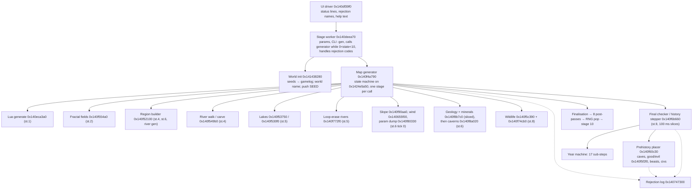

# DF 53.16 world generation — triage and architecture overview

**Source analysed:** Dwarf Fortress 53.16 Classic (Windows x64 build of 2026-08-03), binary + data files, no source code
**Status:** research reference for DEUS/Endrath world generation — not a spec, not a work item
**Date:** 2026-10-10
**Legal note:** Reverse-engineered for learning and interoperability; implement original systems, do not port code or data wholesale.

This is document 01 of the DF reference set. It records what was examined, how, and the shape of the world-generation pipeline and its data model as best established. Later documents (see §6) go deeper per subsystem.

**Evidence tags.** `[BIN:func 0xVA]` a code location (virtual address, image base 0x140000000); `[BIN:string 0xFO]` a string at a file offset in the exe; `[BIN:rtti name]` an RTTI class name; `[BIN:pe-header]` a fact read directly from the executable's PE headers during triage (file-format observation, not a behavioural claim); `[RAW:…]`, `[LUA:…]`, `[DOC:…]` data and documentation files in the archive; `[PUBLIC]` well-known public knowledge (DF wiki, DFHack df-structures), not established from this binary; `[INFERRED]` a reading that goes beyond the evidence. Every behavioural statement about the binary below is a **verified** claim in the adjudicated ledger (`VERIFIED_CLAIMS.md`); the ledger id is given in parentheses, e.g. *(params_rejection-13)*. Items marked *(auditor extra)* were observed by an auditor while verifying a claim but were not themselves put through the two-reviewer process; treat them as one notch below "verified". Long ledger report names are shortened in the ids below: *gap_stage6* = `gap_stage6_salinity_temperature_pass`, *gap_post_map* = `gap_post_map_pipeline_order`, *gap_name* = `gap_name_generation_and_seed_streams`. The short document labels 02a, 02b, 03 and 04 stand for the files named in §6 (`02a_core_techniques_physical_world.md`, `02b_core_techniques_living_world.md`, `03_adaptation_tech_catalog.md`, `04_evidence_appendix.md`).

---

## 1. What was analysed

### 1.1 Archive contents

The analysed copy is the unmodified Classic (no graphics pack) distribution: one 26,480,128-byte `Dwarf Fortress.exe`, the SDL2 / SDL2_image / fmod runtime DLLs with their image-codec dependencies, `readme.txt`, `release notes.txt` (276 KB, headed "Release notes for 53.16 (August 5, 2026)" `[DOC:release notes.txt:39]`), `file changes.txt`, `command line.txt` (the `-gen <id> <seed> "<param title>"` headless generator `[DOC:command line.txt]`), a `licenses/` folder and `data/` with `art`, `init`, `installed_mods` (empty), `sound` and `vanilla`.

The `vanilla` tree holds 25 `vanilla_*` modules. In Classic the `*_graphics`, `vanilla_world_map` and `vanilla_environment` modules carry only an `info.txt`; the object data lives in 158 `objects/*.txt` raw files (about 125k lines). The modules that matter for world generation, with raw-file counts: `vanilla_creatures` 35, `vanilla_creatures_extinct` 10 (the 53.15/53.16 extinct-animal pack `[DOC:file changes.txt]`), `vanilla_plants` 5, `vanilla_entities` 1, `vanilla_materials` 7 (inorganics: 265 definitions, see `04_evidence_appendix.md` §5.1), `vanilla_languages` 6 (2196 words, 84 symbol groups, four translations *(gap_name_generation_and_seed_streams-26)*), `vanilla_interactions` 1, `vanilla_reactions` 4, `vanilla_descriptors` 5, `vanilla_bodies` 4, `vanilla_items` 13, `vanilla_text` 64.

A **Lua procedural layer** sits beside the raws: `data/init/generators.lua` and `globals.lua`, plus `vanilla_procedural/scripts/init.lua` and sixteen generator scripts (creatures, divine, entities, evil, interactions {blessing, curse, disturbance, item_power, mythical, secret}, items, language, materials) — 19 files, about 18k lines. The engine calls into it with a `random_object_parameters` table (demon/night-creature/angel counts, evil cloud and rain counts, divine/mythical material switches, a token prefix) and exposes `trandom`, `get_random_inorganic` and the `raws.register_*` entry points (`one_in`, `add_generated_info`, `generate_from_list` and the sphere pickers are plain Lua built on `trandom`, see `04_evidence_appendix.md` §6); `globals.lua` iterates tables with a key-sorted `pairs` "so the RNG seed is stable" `[LUA:data/init/globals.lua]`.

The **init files** shipped are the `*_default.txt` variants: `init_default.txt`, `d_init_default.txt` (which carries `[LOG_MAP_REJECTS:NO]` and `[EMBARK_RECTANGLE:4:4]`, documented as 2..16 `[DOC:data/init/d_init_default.txt:44-48]`), `announcements.txt`, `arena.txt`, `colors.txt`, `interface.txt` and a `macros/` folder.

Licensing within the archive is explicit: `data/vanilla/readme.txt` releases all `.txt` and `.lua` files under `vanilla_*` into the public domain while images and audio stay copyrighted `[DOC:data/vanilla/readme.txt]`; the executable itself is copyright Tarn Adams / Bay 12 Games `[DOC:readme.txt]`. Quoting raw and Lua text is therefore permitted; the binary's logic is not ours to reproduce.

### 1.2 Executable facts

| Fact | Value | Evidence |
|---|---|---|
| Format | PE32+ (optional-header magic 0x20b), machine x86-64 (0x8664), GUI subsystem | `[BIN:pe-header]` |
| Link timestamp | 2026-08-03 15:51:56 UTC | `[BIN:pe-header]` |
| Linker | 14.41 (MSVC; Visual Studio 2022 family `[PUBLIC]`) | `[BIN:pe-header]` |
| Image base | 0x140000000 | `[BIN:pe-header]` |
| Sections (6) | `.text` VA 0x1000, 0x15de8c7 bytes virtual (0x15dea00 raw) · `.rdata` 0x15e0000 · `.data` 0x1896000 · `.pdata` 0x2696000 · `.rsrc` · `.reloc` | `[BIN:pe-header]` |
| Debug info | One RSDS record naming `…\x64\Release\Dwarf Fortress.pdb`; **no PDB shipped** | `[BIN:pe-header]` |
| Unwind table | 29,875 `RUNTIME_FUNCTION` entries in `.pdata` → function boundaries | `[BIN:pe-header]` |
| RTTI | present; 928 class names recovered | `rtti_all.txt` |
| Imports | 21 DLLs, 464 functions: MSVCP140 121, UCRT (`api-ms-win-crt-*`) 130, KERNEL32 62, SDL2 61, fmod 54, VCRUNTIME140(+_1) 23, others small; no exports, no CLR | `[BIN:pe-header]` |
| Strings | 94,370 ASCII strings of ≥5 chars; 25 UTF-16 | `strings -a -t x -n 5` |

Two consequences shaped the work. First, the 5-character string cutoff hid several load-bearing tokens (`EVIL`, `GOOD`, `HOLY`, `UGLY`, `Calm`, `DIM:`), which had to be read from raw bytes *(auditor extra; see e.g. biomes_regions-18 verdict)*. Second, functions in this binary are large — the worldgen UI driver is 53 KB, the map generator 24.7 KB, the civilisation placer 43 KB, the history stepper 24.8 KB — so most work happened on address ranges inside functions rather than on whole functions.

RTTI gives a map of the data model before any code is read: `world_gen_param_*st` (7, a reflection layer for the parameter editor), ten `feature_init_*st` (cave, pit, volcano, magma pool, outdoor river, cavern/magma/underworld layers, deep special tube, deep surface portal), nine `world_construction_*st` (road, bridge, tunnel, wall and `_square` variants), four `viewscreen_*_regionst` (new, adopt, update, export), ten `site_realization_building_info_*st`, 153 `history_event_*st` names — 134 event classes plus 19 `history_event_collection*st` (base + 18 kinds) — and region references such as `general_ref_subregionst`, `general_ref_feature_layerst`, `region_block_event_sphere_fieldst`, `interaction_source_regionst` `[BIN:rtti …]`.

### 1.3 What was not available

- **No saves.** There is no `save/` directory, so `world.dat` / `world.sav` layouts were read only from the save-writer code (`*START REGION SAVE*` → DIM → MAP → GEOLOGY → SUBREGION markers at `[BIN:func 0x140efd610]`), never from a file.
- **No `prefs/`.** `prefs/world_gen.txt` is absent; the ten standard presets were recovered because they are compiled into the loader *(params_rejection-07)*.
- **No PDB, no symbols.** Function names in this document are our labels, derived from strings, call order and behaviour.
- **No DFHack / df-structures in the archive.** Public structure names are cited as `[PUBLIC]`; one auditor had a df-structures clone for cross-checking, others did not, and the DF wiki was unreachable through the proxy.
- **No execution.** The binary was never run; everything is static analysis of code and data. Nothing here is a measurement of runtime behaviour.

---

## 2. Tooling and method

All work was static and script-driven from a scratch directory, never from inside the archive.

**Strings and addresses.** `strings -a -t x -n 5` produced the ASCII string table keyed by file offset; `addr.py` converts file offset ↔ VA using the section table. String tables are clustered by compilation unit, so `dumprange.py` (strings in a file-offset window) was the fastest way to find a token's siblings — the rejection-type names, the `[WORLD_GEN]` tokens and the biome tokens each form one cluster.

**Cross-references.** `xref.py` scans `.text` for RIP-relative `lea`/`mov`/`cmp` operands and `rel32` call/jump targets that resolve to a given VA, and reports the containing function. This is how every status string, rejection message and parameter global was tied to code.

**Function boundaries.** `func.py` reads the `.pdata` `RUNTIME_FUNCTION` table and merges unwind-chained entries; its ranges proved reliable. Caveat: leaf functions without an unwind entry (the vegetation helper at `[BIN:func 0x140f772a0]`, the tile attribute getter `[BIN:func 0x1403d42c0]`, the latitude blend helper `[BIN:func 0x14075b0d0]`) are invisible to it and had to be bounded by hand.

**Disassembly.** One full `objdump -d -M intel` of `.text` (5.4 M lines, `text_dis.txt`) was grepped rather than re-run. On top of it: `calls_in.py` (direct call targets in a range, in order, with callee sizes), `strs_in.py` (string literals referenced in a range, in address order — labels an unknown function in seconds), `stage_order.py` (order of status/rejection string references inside a function, which is how the pipeline order was first recovered).

**Decompilation.** angr 10 (CFGFast restricted to a function's `.pdata` range, then the decompiler) produced pseudo-C for 53 functions, saved under `decomp/`. Decompiled text was used to understand control flow, then confirmed in disassembly; its synthetic struct and field names were never trusted as such. The map generator itself (24.7 KB) yielded no codegen, so every claim about its body rests on disassembly.

**Constants and tables.** Two recurring decoding tasks: (a) jump tables read from `.rdata` bytes to recover enum encodings (POLE, biome index, field index, rejection id → display name, name-type → body); (b) MSVC magic-multiply division idioms, e.g. `0x7f017e03 >> 47` = /66049 (= 1/257²), `0x7f807f81 >> 39` = /257, `0x51eb851f >> 37` = /100, `0x10624dd3` with `sar 6` = /1000, `0x2aaaaaab` = /6 or, with one extra shift, /12. The last one caused the single most-repeated analyst error (two reports said rainfall/6 where the code divides by 12 *(gap_stage6_salinity_temperature_pass-10)*).

**Data files.** Raws were counted per definition with a small parser (`rawstats.py`); engine flag tables were recovered by pairing string literals with the DWORD stored beside them in static initialisers (`tokmap.py`); Lua was read directly. PE imports were resolved with `pefile` where an IAT slot mattered (`GetTickCount` at `0x1415e01e8` drives the 100 ms stepper budget *(params_rejection-25)*).

**Adversarial verification.** Each of the nine analyst reports was re-examined by an independent auditor against the same binary (six also by a second skeptic); every claim was re-read at its cited addresses and given a status. Result: 214 claims kept (155 verified, 6 public, 53 inferred), 14 refuted, 193 auditor extras. Recurring failure modes: RVAs mistaken for file offsets; address order mistaken for control flow (the stage-6 slice path sits after the stage-7 compare, §3.3); UI label order mistaken for execution order (§3.1); magic divisors off by a factor of two; and absence claims never checked against the whole binary.

---

## 3. The world-generation pipeline

### 3.1 UI strings versus execution order

The worldgen screen prints a cumulative list of status lines, and the line shown while a stage runs often names the *previous* or *next* stage's work. The driver `[BIN:func 0x140df39f0]` prints line *k* whenever the stage word is ≥ *k* for the first seven lines *(params_rejection-25, gap_post_map_pipeline_order-20)*; the table below pairs each label with what the generator is actually doing at that time.

| Stage word | Label printed from this stage | What actually runs in this stage (block guard) |
|---|---|---|
| 1 | Preparing elevation... | Init: clear world, allocate W×H tiles, run Lua object generation `[BIN:func 0x140f4a7fc]` *(params_rejection-13)* |
| 2 | Setting temperature... | All seven fractal climate fields (mesh seeding, border lines, edge-ocean retry, interior fill) `[BIN:func 0x140f4ab05]` *(params_rejection-13; elevation_fields-02, -08)* |
| 3 | Running rivers... | Latitude pass, peaks, elevation bands ± shifts, edge-ocean check, 33/66 evenness checks, initial biome square counts, vegetation seed, volcano count, elevation compression `[BIN:func 0x140f4ca7c]` *(params_rejection-15, -19, -20; biomes_regions-07 inferred for the compression's scope)* |
| 4 | Forming lakes (+ " and minerals...") | First region build and "<Biome> region count" checks; river-start check; `EROSION_CYCLE_COUNT` erosion cycles, one per tick; final-river sweep on the last cycle `[BIN:func 0x140f4e1c4]` *(hydrology-01, -03, -07)* |
| 5 | Growing vegetation... | Lakes from sinks (one column of sinks per tick), majority fixpoint, then the loop-erase river extraction `[BIN:func 0x140f4f0bd]` *(hydrology-01, -11, -13)* |
| 6 | Verifying terrain... | Tick 0: Mountain-Slope, volcano cones, river-valley flattening, orographic rain, Mountain-Slope again, temperature corrections, vegetation recompute, salinity rings, second region build, `SUBREGION_MAX`, parameter dump; later ticks: sliced geology/minerals, then caverns `[BIN:func 0x140f4f1e9]` *(gap_stage6-04, -12; biomes_regions-13; gap_stage6-14 and geology_underground-01 inferred for the cones and the geology-before-caverns order)* |
| 7 | Importing wildlife... | Post-erosion low/medium/high altitude re-check (ids 32–34) `[BIN:func 0x140f50239]` *(hydrology-18)* |
| 8 | (display switches to the history view) | Wildlife importer and a per-tile initialisation pass `[BIN:func 0x140f5040e]`, `[BIN:func 0x140f74cb0]` *(vegetation_wildlife-05; gap_stage6-21 inferred for the pass's content)* |
| 9 | Prehistory init... / Placing caves... / … / Finished prehistory...; Recounting legends... (static) | Final region checks → prehistory placer phases → 17-sub-step year machine → finalisation `[BIN:func 0x140f5042d]` *(gap_post_map-02, -06, -07, -08)* |
| 10 | — | Done; the worker pops the SEED stream *(auditor extra)* and hands over to the legends/export screens |

Two nuances: "Growing vegetation..." and "Verifying terrain..." are additionally gated on the mineral slice counters, so they only appear once stage 6's sliced work is done *(vegetation_wildlife-23, inferred)*; and within stage 9 the prehistory labels **are** aligned with the running phase — the label shown while byte *k* is the highest set phase byte names the phase that will set byte *k+1* *(gap_post_map-06)*. The off-by-one problem is confined to stages 1–8.

### 3.2 Who calls what



Anchors: the UI driver `[BIN:func 0x140df39f0–0x140e00944]` references every status and rejection string; the worker `[BIN:func 0x140deea70–0x140df0df8]` calls the generator at `0x140df099e` only while `0 < state < 10` *(params_rejection-13)*; the generator runs **exactly one sub-stage per call** and advances the stage word in its common tail at `0x140f506eb` *(params_rejection-13)*; the final checker is called at `0x140f505aa` *(params_rejection-25)*, the placer from inside it at `0x140f6bea3` *(biomes_regions-17)*, and the Lua entry at `0x140f4aae8` with a copy of the SEED string *(gap_post_map-22, inferred for the "no push" part)*.

### 3.3 Stage-by-stage execution order

The stage machine is a chain of `cmp stage, N` guards inside one function *(params_rejection-13; geology_underground-22)*. Stage contents, with the rejection ids each stage can raise:

```
stage 1  init: clear world, allocate W×H tiles, year := 1, Lua `generate` on a nested stream
stage 2  fields: sentinel clear; mesh seeding; four 1-D border lines; edge-ocean forcing
         and retry; volcanism hotspots; interior fractal fill
stage 3  checks: latitude term; peaks (id 0); bands + shift down/up (1-5); edge oceans (6);
         evenness of rain/drainage/savagery/volcanism (7-10); INITIAL biome square
         counts (11-19); vegetation seed; volcanos (20); elevation compression
stage 4  regions + erosion: tick 0 region build, "<Biome> region count" (21-29), river
         starts (30); each tick one erosion cycle of carving walks (+1 % cliff clip);
         last cycle: final-river sweep, then strip rivers above elevation 150
stage 5  water: lakes from sinks (one column per tick); river/lake majority fixpoint;
         loop-erase extraction into river objects; naming; brooks
stage 6  terrain finalisation: tick 0 slope ramp, volcano cones, valley flattening,
         orographic rain, slope ramp, temperature lapse/squash/wet-cap, vegetation,
         salinity rings, SECOND region build, SUBREGION_MAX (31), river-sort check,
         parameter dump; later ticks geology + minerals in ~50 ms slices, then caverns
stage 7  post-erosion altitude re-check (32-34)
stage 8  wildlife importer; per-tile initialisation pass; zero the 8 prehistory phase bytes
stage 9  final checker in 100 ms slices: FINAL biome region counts (43-51) → code 2;
         placer phases A..G (caves 35-38, civs 39-42, crops 52) → code 2; year machine
         (17 sub-steps, year++ in 13, stop test in 16); finish → one finalisation
         element per frame → 8 post-passes → pop
stage 10 done
```

Status notes on the ladder: the elevation compression at the end of stage 3 is ledger-inferred only in its "used exclusively here" wording; its arithmetic was reproduced by both auditors *(biomes_regions-07)*. The region builder `[BIN:func 0x140f52100]` therefore runs at least three times per generation (stage 4, stage 6, and inside the river generator at `0x140f79889`) *(biomes_regions-13 verdict)*. Lakes are formed **before** rivers are extracted, despite the label order *(hydrology-01)*. The geology/mineral builder's code sits physically after the stage-7 compare (`0x140f50294–0x140f502d0`, reached by a forward jump from the stage-6 slice test at `0x140f50221`); one report read that as "stage 7", but by control flow it belongs to stage 6's later ticks and the cavern builder is called only when its progress counter reaches its total *(geology_underground-01 verdict; gap_stage6-20 verdict; auditor extras)*.

### 3.4 The rejection system and its three biome checkpoints

Every check is numbered (ids 0–52), consults a per-id allow flag at `0x1424e5a58`, and on failure calls the log writer `[BIN:func 0x140747300]` with (message, id), which increments a per-id counter, records the last id and — when `LOG_MAP_REJECTS:YES` — appends to `map_rejection_log.txt` *(params_rejection-15, -17, -18; the last two inferred only in their wording)*. The generator never loops internally: every failing check jumps to a common exit returning 1, the final checker returns 2, and the worker then bumps the reject counter and resets the stage word — to **2** for code 1 (regenerate the fields; init, seeding and Lua generation are skipped and the RNG stream simply continues) or to **1** for code 2 (full re-initialisation) *(params_rejection-14)*. Fifty-three ids collapse to 27 player-facing names through a byte table and a jump table in the UI *(params_rejection-16)*.

Three checkpoints count biomes at three moments:

| Checkpoint | Ids | Where | Unit | Threshold source |
|---|---|---|---|---|
| "Initial <biome> square count fails by" | 11–19 | stage 3, pre-compression classifier histogram *(params_rejection-20; biomes_regions-07 inferred)* | tiles | `REGION_COUNTS[biome].a` |
| "<Biome> region count fails by" | 21–29 | stage 4 tick 0, after the first region build; a region counts only at ≥35 tiles (mountains ≥20 lowland-bordering), lakes never *(biomes_regions-12)* | regions | `REGION_COUNTS[biome].b` |
| "Final <biome> region count fails by" | 43–51 | stage 9 prehistory init in the final checker `[BIN:func 0x140f6b660]`; failure is code 2 *(gap_post_map-02, -04)* | regions | `REGION_COUNTS[biome].c` |

The remaining families are: peaks and elevation bands with the in-place ±10 "shift" repair (0–5) *(params_rejection-19)*; edge oceans (6: complete = every edge tile < 100, partial = at least an eighth) *(params_rejection-22)*; band minimums for the four other fields (7–10, bands < 33 / 33–65 / ≥ 66; no variance measure exists) *(params_rejection-20)*; volcanos (20, volcanism ≥ 100) *(geology_underground-21)*; river starts (30, tiles ≥ 150 before erosion) *(hydrology-03, -04)*; subregion cap (31) *(biomes_regions-13)*; post-erosion bands (32–34, with "high" now meaning ≥ 150) *(hydrology-18)*; caves and civilisations (35–42) and farming-without-crops (52), raised by the placer *(geology_underground-20 inferred; vegetation_wildlife-18)*. Terrain checks are skipped for any field supplied as a painted `PS_*` preset *(params_rejection-23)*.

### 3.5 Seeds and RNG streams

The engine keeps a **stack of MT19937 states** (selector word, depth word, ten 624-word buffers, per-depth purpose tags) with push-from-string, push-from-value, push-from-three-values and pop operations; the draw routine `0x140eb1820` ignores the purpose tags *(gap_name-18, -19)*. World init parses the four seed strings, logs them to `gamelog.txt`, pushes NAME_SEED only to name the world and pops it inline, then pushes SEED *(gap_name-20)*. SEED therefore drives all map stages, including the stage-1 Lua object generation, which nests its own stream on a copy of SEED *(auditor extra)*. The placer pushes HISTORY_SEED at megabeast placement and pops only on its rejection exits, so the pop at the end of stage 9 (`0x140f50587`) restores SEED *(gap_post_map-13)*, and the worker pops SEED at stage 10 *(auditor extra; gap_name-21 refuted → corrected reading)*. CREATURE_SEED is handed to the Lua entry for procedural creatures *(gap_name-22, inferred)*. The uniform draw used throughout the generator is `random(n) = (raw mod 0x7fffffff) / (0x7fffffff/n + 1)` *(elevation_fields-22; geology_underground-25)*. Because a rejection never reseeds, retries continue the same sequence, which is what makes the rejection history itself reproducible from the seeds.

**Copy-risk.** MT19937 itself is public domain, but the buffer-stack layout, the string-folding seeder and the `(0x7fffffff/n)+1` reduction are DF's implementation and are recorded here only as evidence. DEUS derives named streams its own way (03, T4).

---

## 4. Key data structures and the multi-scale representation

### 4.1 Objects

| Object (our label) | Size | Verified content | Status |
|---|---|---|---|
| `world_gen_param` | 0x4c8 B | Six `std::string` (title, SEED +0x20, HISTORY_SEED +0x40, NAME_SEED +0x60, CREATURE_SEED +0x80, custom name +0xa8); dims +0xa0/+0xa4; ~110 scalars; `int[10]×3` REGION_COUNTS at +0xe0/+0x108/+0x130; `int[24]×4` field min/max/xvar/yvar at +0x1e8/+0x248/+0x2a8/+0x308; six `{mesh,w1..w5}` frequency structs from +0x400; `int[3]×5` RANGES in (mid, low, high) storage order; nine flag bytes; pointer to painted-preset rows at +0x490. Live copy at `0x1424f36c8` | verified *(params_rejection-01, -02, -04, -05)* |
| Worldgen status block | at `0x1424e5a50`; ≥ 0xcd0 B *(auditor extra)* | stage (u16), `num_rejects`, `skip_reject[53]`, `reject_type[53]` counters, `last_reject`, requested dims, `have_logged_parameters`; stepper state (sub-step counter, scratch vectors), finalisation counters, phase bytes | verified for the named fields *(params_rejection-13, -14; gap_post_map-01, -08)*; layout name match with df-structures `world_generatorst` `[PUBLIC]` |
| World object | — | width +0xa0, height +0xa4, pole mode +0xb0, wind-mirror +0xb2, sites +0x178, landmasses +0x220, regions +0x238, geo-biomes +0x268, mountain peaks +0x280, rivers +0x298, tile column pointers +0x2b0, 16×16 block pointer grid +0x483c8 | verified *(elevation_fields-03; biomes_regions-10; hydrology-14; geology_underground-02; gap_post_map-10)*, except sites +0x178 *(gap_post_map-19, inferred)* |
| World tile (`region_map_entry`) | 0x70 B | int32 feature-layer elevations +0/+4; flag bit-array (pointer +0x20, byte count +0x28); int16 slots from +0x30: elevation, rainfall, vegetation, temperature, evilness, drainage, volcanism, savagery (+0x30..+0x3e), stage-8 side-pass state +0x40..+0x4a (the "weather" reading is `[INFERRED]`, gap_stage6-21/-22), salinity +0x4c; int32 region id +0x60, landmass id +0x64; int16 geo_index +0x68 | verified offsets *(elevation_fields-03; biomes_regions-22 inferred for names; gap_stage6-01; geology_underground-02)*; slot names for vegetation/evilness `[PUBLIC]` *(elevation_fields-24)* |
| `world_region` | 648 B | kind +0x7c (0–9), x/y tile lists, 42-bin biome histogram +0xe0, totalnum/totalboundnum/savage subsets, centre and bbox, is_evil/is_good, evilgood_pic, has_bogeymen, dead_veg_chance; regions also carry populations and a name, whose fields were not located (ledger open question) | verified *(biomes_regions-10)* |
| `world_landmass` | 192 B | area +0x7c, bbox, tile lists, name (small island ≤5 / island <100 / continent) | verified *(biomes_regions-10; gap_name-14)* |
| Mountain peak | 0x98 B | x/y +0x78/+0x7a, flag array +0x80 (bit 0 volcano `[PUBLIC]`), height +0x90 | layout inferred *(gap_stage6-14; 0x98-byte allocation is an auditor extra under params_rejection-21)* |
| `world_river` | 264 B | name (0x78), path_x +0x78, path_y +0x90, flow +0xa8 (prefix sum of rainfall), exit_tile +0xc0 (0–15), elevation +0xd8, end pos +0xf0/+0xf2 | verified *(hydrology-14; -25 inferred for "flow is rainfall"; exit_tile +0xc0 and elevation +0xd8 are hydrology-26 inferred / auditor extra)* |
| Geo-biome / geo-layer | — / 112 B | kind, index, layer pointers; layer type (9 values), material, vein vectors (material, nested-in, inclusion type, depth code), top/bottom | verified *(geology_underground-02, -12)*; save layout *(-03 inferred)* |
| `feature_init` (cavern/magma/underworld region) | 280 B | layer index, displayed number, water, openness min/max, passage-density min/max, a 0–100 percentage | builder gating verified *(geology_underground-16)*; size and field list auditor-confirmed inside the otherwise refuted -17 (its bias direction was wrong) |
| World site (cave) | 0x540 B | type 2 at +0x80, two RNG seeds +0x208/+0x20c, size from `[CAVE_MIN_SIZE, CAVE_MAX_SIZE]` | inferred *(geology_underground-20; 0x540 allocation and type word auditor-confirmed)* |
| Population record | 0x28 B | type code +0, raw index +2, one rolled count in both count fields, three −1 fields | auditor extra *(vegetation_wildlife-25 refuted → corrected)* |
| `language_name` | 0x74 B | first name, nickname, `int32 words[7]`, `int16 parts[7]`, language, type, has_name | verified *(gap_name-02)* |

Tile flag bits used by worldgen: 0 river, 2 new-lake sink, 4 scratch/visited, 5–8 river links N/S/E/W, 13 chosen peak, 14 lake, 15 brook, 17 original river source *(hydrology-24, inferred; bit names corroborated by df-structures `[PUBLIC]`; bit 14 = lake verified via the classifier in biomes_regions-01)*; bit 3 = site `[PUBLIC]`.

**Copy-risk.** The sizes, offsets and bit numbers in this table are DF's internal layout, recorded so that a reader can re-find the evidence. A DEUS data model must not mirror them; 03 §5 gives the shapes to keep (fields as separate typed arrays, flags as named constants, regions and rivers as JSON records).

### 4.2 The scale ladder

DF represents the world at several nested resolutions. Only the first three levels and the beginning of the fourth are touched by the worldgen code examined; the rest is public knowledge about the game.

1. **World tile grid, W×H ∈ {17, 33, 65, 129, 257}²** — the only resolution at which the climate fields exist; the editor caps the mesh exponent and the wind helper rescales rows per size *(elevation_fields-04)*. Everything in stages 2–8 is a per-tile int16 or a flag bit.
2. **Regions (subregions) and landmasses** — 4-connected components of equal region *kind* (10 kinds) and 8-connected non-ocean components, both recomputed from tiles by label propagation; tiles carry only the ids *(biomes_regions-09 inferred for the connectivity rule, -10 verified for the objects)*. Biome itself is never stored: a 1.2 KB classifier derives one of 42 world-tile biomes on demand from elevation, temperature, rainfall, drainage, salinity, the lake flag and latitude *(biomes_regions-01, -02)*.
3. **Geo-biomes** — about W·H/100 vertical stacks of soil and stone layers with mineral inclusions, grown over the map by an anisotropic seeded flood; a tile stores one int16 index *(geology_underground-02, -04, -06)*.
4. **Feature layers** — up to five (three caverns, magma, underworld), each a W×H grid of region ids with one `feature_init` per region; the first cavern top per tile is the 5×5 minimum surface elevation minus `LEVELS_ABOVE_LAYER_1` *(geology_underground-16)*. `LEVELS_ABOVE_LAYER_2..5` and `LEVELS_AT_BOTTOM` are subtracted inside the same builder, while the above-ground budget `LEVELS_ABOVE_GROUND` is read only by local-map code *(geology_underground-19, inferred; auditor extra)*.
5. **Mid-level 16×16 blocks** — the world object keeps a `(W+15)/16 × (H+15)/16` grid of per-block cache pointers freed yearly *(gap_post_map-10)*, the river lookup uses a 16×16 block cache *(hydrology-15)*, and each river tile's `exit_tile` is a 0–15 crossing position *(hydrology-26, inferred)*. That each world tile is 16×16 "region tiles" is `[PUBLIC]`; the binary is consistent with it but the mid-level map was not analysed.
6. **Local 48×48 embark tiles** — `[PUBLIC]` only. The shipped `EMBARK_RECTANGLE` range 2..16 `[DOC:d_init_default.txt]` and the `feature_init_*` / `site_realization_building_info_*` RTTI families `[BIN:rtti]` mark where the local-map code starts, but it was out of scope.

### 4.3 Abstract populations, sites and history

Flora and fauna are stored **per region, not per tile**: the stage-8 importer intersects each raw's BIOME flags with the region's biome histogram, weights each raw by `FREQUENCY × max(W,H)·100/257` (read by the auditors as a reach that pulls a per-raw random home point toward the region centre `[INFERRED]`), gates SAVAGE creatures on untamed tiles, caps distinct animal kinds at `min(50, 7 + tiles/10)` and appends population records through a shared helper *(vegetation_wildlife-06, -07, -08, -11)*. Good and evil regions rebuild their populations from GOOD/EVIL-tagged raws when alignment is placed *(biomes_regions-16, inferred for the flag semantics)*.

Sites begin as caves (world sites of type 2) placed by the prehistory placer; civilisations, lairs and settlements are added in the same 43 KB function and by the year machine *(vegetation_wildlife-17; gap_post_map-05 refuted only on "one phase per call": civilisation placement spans many stepper calls)*. History is a vector of polymorphic `history_event_*st` objects (153 RTTI classes including collections) plus historical figures, entities, ages and a living-megabeast list; the vector identities are inferred from UI counters and reserve hints *(gap_post_map-19, inferred)*. The year machine runs 17 sub-steps per year, increments the year in sub-step 13, and in sub-step 16 recomputes ages, snapshots the region map every tenth year and evaluates the stop test (`END_YEAR`, `BEAST_END_YEAR` percentage, or "Use world now") *(gap_post_map-08, -09, -10)*.

---

## 5. Parameter system at a glance

The entire parameter set is one flat struct serialised as `[WORLD_GEN]` lines by a single writer `[BIN:func 0x140f80330]` and parsed by a single loader `[BIN:func 0x140de5b10]` *(params_rejection-01)*. Grouped by the stage that consumes them:

| Family | Tokens | Consumer |
|---|---|---|
| Identity and seeds | `TITLE`, `CUSTOM_NAME`, `SEED`, `HISTORY_SEED`, `NAME_SEED`, `CREATURE_SEED`, `DIM` | world init, stage 1 |
| Field synthesis | `[FIELD:min:max:xvar:yvar]` for ELEVATION, RAINFALL, TEMPERATURE, DRAINAGE, VOLCANISM, SAVAGERY; `*_FREQUENCY:mesh:w1..w5`; `POLE`; painted `PS_EL/RF/TP/DR/VL/SV` rows | stage 2 *(elevation_fields-05, -06, -11, -23)* |
| Terrain validation | `PEAK_NUMBER_MIN`, `PARTIAL/COMPLETE_OCEAN_EDGE_MIN`, `VOLCANO_MIN`, `ELEVATION_RANGES`, `RAIN/DRAINAGE/SAVAGERY/VOLCANISM_RANGES` (low:mid:high square minimums), `REGION_COUNTS[biome].a` | stage 3 *(params_rejection-04, -05, -20, -22)* |
| Regions, rivers, erosion | `REGION_COUNTS[biome].b`, `RIVER_MINS` (pre-erosion minimum, exploratory rivers per cycle), `EROSION_CYCLE_COUNT`, `PERIODICALLY_ERODE_EXTREMES`, `OROGRAPHIC_PRECIPITATION`, `SUBREGION_MAX` | stages 4–6 *(hydrology-02, -03, -06; gap_stage6-24)* |
| Underground | `CAVERN_LAYER_COUNT`, `CAVERN_LAYER_OPENNESS/PASSAGE_DENSITY/WATER_MIN/MAX`, `HAVE_BOTTOM_LAYER_1/2`, `LEVELS_ABOVE_*`, `LEVELS_AT_BOTTOM`, `MINERAL_SCARCITY`, `CAVE_MIN/MAX_SIZE`, `MOUNTAIN/NON_MOUNTAIN_CAVE_MIN`, `ALL_CAVES_VISIBLE`, `SHOW_EMBARK_TUNNEL` | stage 6 geology/caverns, stage 9 placer, local maps *(geology_underground-16, -19, -20)* |
| Alignment | `GOOD_SQ_COUNTS`, `EVIL_SQ_COUNTS` (small/medium/large square budgets) | placer phase B *(biomes_regions-14)* |
| Civilisations and beasts | `TOTAL_CIV_NUMBER`, `TOTAL_CIV_POPULATION`, `SITE_CAP`, `PLAYABLE_CIVILIZATION_REQUIRED`, `MYTHICAL_SITE_NUM`, `MEGABEAST_CAP`, `SEMIMEGABEAST_CAP`, `TITAN_NUMBER`, `*_ATTACK_TRIGGER`, `DEMON_NUMBER`, night-creature `*_NUMBER`s, `SECRET/REGIONAL/DISTURBANCE_INTERACTION_NUMBER`, `EVIL_CLOUD/RAIN_NUMBER`, `GENERATE_*`/`ALLOW_*` flags, `REAL_WORLD_EXTINCT` | placer and Lua generators *(vegetation_wildlife-13, -14, -17; biomes_regions-20)* |
| History | `END_YEAR`, `BEAST_END_YEAR:year:percent`, `REVEAL_ALL_HISTORY`, `CULL_HISTORICAL_FIGURES`, `EMBARK_POINTS` | year machine stop test *(gap_post_map-09, -23)* |

Encodings worth knowing because they contradict folklore: the mesh value is **1 = Ignore, 2..6 = 2×2 .. 32×32** *(params_rejection-03 refuted → corrected)*; `POLE` 0 is written as the literal `NONE` *(params_rejection-06)*; `*_RANGES` are stored (mid, low, high) but written low:mid:high *(params_rejection-04)*; `REGION_COUNTS` index 5 (lake) is skipped *(params_rejection-05)*; `REAL_WORLD_EXTINCT` is 0 extinct, 1 savage islands only, 2 untamed wilds only (default), 3 any wilderness, 4 also domesticated *(vegetation_wildlife-13)*.

**Presets.** The ten `LARGE/MEDIUM/SMALL/SMALLER/POCKET × ISLAND/REGION` sets are compiled in: `prefs/world_gen.txt` is read first and the presets are synthesised only if it yields nothing *(params_rejection-07)*. A REGION preset is nothing but title, square dimension (257/129/65/33/17) and a **dimension-default function** that scales most minimums in proportion to area relative to 257² *(params_rejection-08, -09, -10)*; ISLAND presets add explicit overrides (four complete ocean edges, lower peak/volcano/river/cave/civ minimums, explicit ranges and region counts) *(params_rejection-12)*. The basic-settings "Mineral occurrence" labels write `MINERAL_SCARCITY` values of 50000 / 10000 / 2500 / 500 / 100 for Very rare … Everywhere, not the public 100000 … 100 *(geology_underground-24 refuted → auditor extra)*.

**Copy-risk note.** The flat-record + text round-trip + area-scaled defaults + numbered checklist with allow flags is a generic architecture and worth reusing. The specific numbers — the 66049 reference area, the 33/66 and 100/300 bands, the per-biome fractions in the default `REGION_COUNTS`, the island override tables — are DF's tuning and encode its biome rules; derive Endrath's own from Endrath's biome table rather than transcribing these.

---

## 6. Where each later document goes deeper

| Document | Coverage | Source reports |
|---|---|---|
| **02a** — the physical world (file `02a_core_techniques_physical_world.md`) | Fractal fields, mesh/weighted-range seeding, borders and edge-ocean retry, latitude temperature, peaks and bands; erosion as carving walks, lakes, loop-erase extraction, tributary merging, salinity; the biome classifier, regions and landmasses, good/evil placement, savagery; geo-biomes, layer recipes, minerals, feature layers, caves; derived vegetation and the wildlife importer — with original pseudocode per section | `elevation_fields`, `hydrology`, `gap_stage6_salinity_temperature_pass`, `biomes_regions`, `geology_underground`, `vegetation_wildlife` |
| **02b** — the living world and the machinery (file `02b_core_techniques_living_world.md`) | Civilisation placement, the prehistory placer phases, the 17-sub-step year machine and stop test; the Lua procedural layer; the parameter record, presets, rejection ids and checkpoints in depth; seed streams and determinism; save and export formats | `params_rejection`, `vegetation_wildlife`, `gap_post_map_pipeline_order`, `gap_name_generation_and_seed_streams` |
| **03** — adaptation catalogue (file `03_adaptation_tech_catalog.md`) | Eighteen techniques ranked P0–P2, each with the DEUS hook it could serve, an original sketch and a copy-risk line; data-format patterns; what not to copy | all nine reports' adaptation sections and the ledger's refuted/extras lists |
| **04** — evidence appendix (file `04_evidence_appendix.md`) | Function anchor map, string tables, RTTI inventory, PRNG and stream facts, raw-data censuses, Lua inventory, refuted and mislabelled claims, reproduction notes | all nine reports and the ledger |

The parameter system itself (this document's §5, 02b §4 and the token table in 04 §2.4) is documented from `params_rejection`; readers needing the exact check order and the 53→27 name mapping should start from ledger ids `params_rejection-15` and `-16`.
